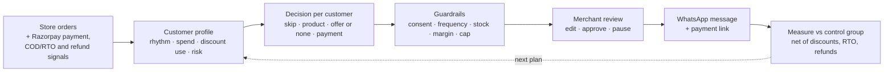
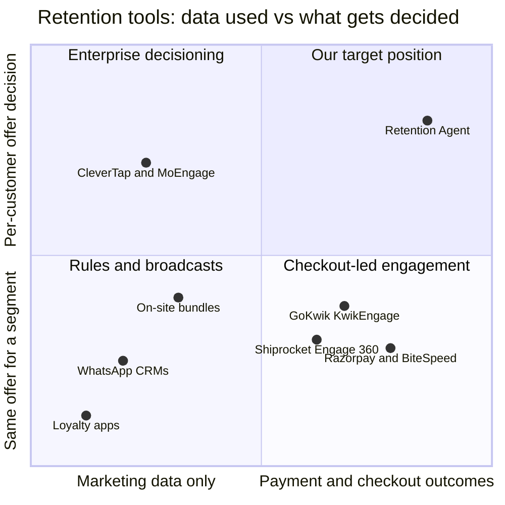
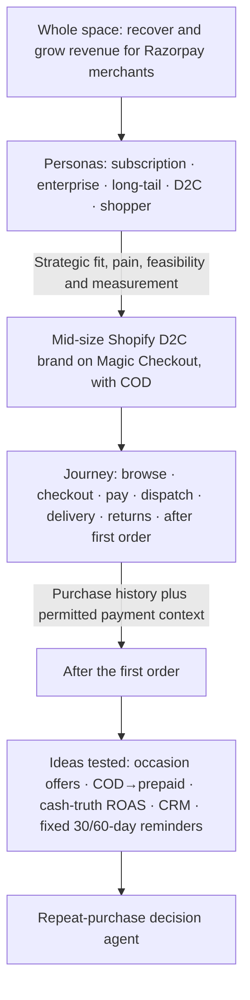

# Retention Agent

**A proposed repeat-purchase decision agent for Razorpay Agent Studio.** It helps a D2C merchant review whom to contact, when, which product and offer to use, and whether to encourage online payment. The prototype demonstrates these decisions and estimates extra contribution against a simulated control group. Real causal impact still needs a live experiment.

**▶ Live demo: [smart-retention-razorpay.lovable.app](https://smart-retention-razorpay.lovable.app/)** (no login needed; start with **Guided tour** in the header)

> Razorpay × ISB AI PM Build Challenge · **Track 2: Recover and Grow with AI**
> Independent concept prototype. Not an official Razorpay product. All merchant data is synthetic and nothing in this app contacts a real person or service.

---

## In 30 seconds

| | |
|---|---|
| **Merchant** | Starting persona: growth or retention manager at a mid-size Shopify D2C brand, initially with Razorpay Magic Checkout and COD orders. The demo averages 5K orders a month; the persona still needs merchant validation |
| **Problem** | Working hypothesis: broad campaign offers can spend discounts on customers who would reorder anyway, while attributed sales can obscure COD/RTO and refund losses |
| **Signal** | Product and purchase history from Shopify; reconciled payment, refund and delivery outcomes from connected sources; permitted Razorpay risk enrichment where available. All are simulated here |
| **Decision** | Per customer: include or skip · product · discount or none · pay-online nudge for risky COD · channel |
| **Merchant control** | Suggested campaigns become editable drafts. Nothing is sent until the merchant approves. Pause any time. Caps on discount, margin and budget |
| **Measurement** | Every approved campaign reserves a control group. The demo estimates extra profit after discounts, RTO and refunds; it provides a measurement workflow, not measured business proof |
| **Demo merchant** | *Nira Botanics*, a fictional skincare and haircare brand: 30,000 orders, 12,000 customers, six months of history |



---

## 1. The problem we chose

**The merchant:** a growth or retention manager at a mid-size Shopify D2C brand. Acquisition cost, incentive spend and unsuccessful COD deliveries are the economic pressures we chose to investigate. Public market research supplied directional context; no merchant has been interviewed for this prototype, and its price, volume and response assumptions are not calibrated to a real brand.

**The current-workflow hypothesis:** merchants may use WhatsApp/CRM tools, fixed-delay flows or festive broadcasts with broad offers. Existing platforms can also support richer targeting and predictive timing; we do not assume every merchant sends the same coupon. Campaign attribution credits qualifying orders under a tool's attribution rules, which does not by itself establish what the campaign caused.

**Where it breaks:**

1. **Potential discount waste.** A customer who would reorder at full price may receive an incentive. Past coupon use alone cannot establish whether that incentive was unnecessary; the policy needs testing.
2. **RTO hides inside "revenue".** A COD reorder that is refused at the door shows up as a campaign win and as a logistics loss.
3. **The finance question:** *"How much extra contribution did this campaign create after discounts, delivery losses and refunds?"* Attribution alone cannot answer it. A randomised control group is the proposed way to estimate it.

**Why this could matter to Razorpay:** its visible D2C investment, checkout distribution and payment intelligence suggest strategic fit. Combining Shopify product history with entitled risk signals and reconciled collections could support better retention decisions. Catalog and delivery data still require integrations; we do not claim that Razorpay already exposes every required field or that its native and partner products never address retention.

## 2. What the research found

About two weeks of desk research went into this: two long-form deep-research reports, a stage-by-stage map of the D2C customer journey, a scan of the retention tools available in India, and around 30 published Magic Checkout case studies. Figures are mostly vendor-reported or from industry blogs, and they're labelled that way. Full detail and sources: **[docs/RESEARCH.md](docs/RESEARCH.md)**.

### 2.1 The core insight: retention is not the same as *profitable* retention

| What we found | Source type |
|---|---|
| Only 20–30% of first-time D2C buyers order again within 90 days, so brands push repeat orders hard | Industry blogs, founder surveys |
| The usual lever is a discount, and stacked discounts reach 25–30% of revenue for many brands | Founder surveys, industry commentary |
| Discount-led retention trains customers to wait for the next code; timely reminders tend to hold more long-term value than deep discounts | Deep-research synthesis of published studies |
| Most retention tools headline *attributed* revenue, so an order that would have happened anyway can be credited to the message, and its discount becomes margin given away | Vendor documentation, deep-research synthesis |
| COD orders return at 25–30% vs 2–3% for prepaid, so a "won" COD reorder can lose money after RTO | Logistics vendor blogs |

**So the question isn't "how do we get more repeat orders?". It's "which repeat orders are worth paying for, and what did we actually earn?"** That's why the product decides *who needs a discount at all*, nudges risky COD buyers to pay online, and measures extra contribution against a control group after discounts, RTO and refunds.

### 2.2 The customer journey and how crowded each stage is

We mapped a shopper's path through a Shopify D2C brand on Magic Checkout. For each stage we noted what Razorpay can see and which tools already act there.

```mermaid
flowchart LR
    S1["01 Discover"] --> S2["02 Browse & cart"] --> S3["03 Checkout & pay"] --> S4["04 Before dispatch<br/>(COD)"] --> S5["05 Delivery / RTO"] --> S6["06 Returns"] --> S7["07 Use, between<br/>orders"] --> S8["08 Reorder &<br/>win-back"]

    classDef outside fill:#eceef1,stroke:#8a929c,color:#3d434b
    classDef crowded fill:#f9e6e1,stroke:#b0412c,color:#6e2516
    classDef partly fill:#f8eed6,stroke:#94680f,color:#5c4008
    classDef open fill:#e9efff,stroke:#2350d2,color:#0c2a80
    class S1 outside
    class S2,S3,S4 crowded
    class S5,S6 partly
    class S7,S8 open
```



*Grey = outside Razorpay's data · Red = crowded · Amber = partly served · Blue = where we focus*

| Stage | What the shopper does | What Razorpay can see | Tools already acting | How crowded |
|---|---|---|---|---|
| 01 Discover | Sees an ad or creator post | Nothing first-party | Meta, Google, creators | ●●● (outside Razorpay) |
| 02 Browse & cart | Adds to cart; many leave | Cart + phone (Magic Checkout OTP) | Razorpay cart-recovery agent, GoKwik, BiteSpeed, KwikEngage | ●●● |
| 03 Checkout & pay | Picks UPI, card or COD | Payment method, failure code, RTO score | Magic Checkout, GoKwik, Shopflo, payment retry | ●●● |
| 04 Before dispatch | A COD order waits to ship | COD orders and risk | RTO Shield, COD confirmation agent, GoKwik, Shiprocket | ●●● |
| 05 Delivery / RTO | Accepts or refuses the parcel | RTO outcome, if shared | Shiprocket, ClickPost, RTO insights | ●●○ |
| 06 Returns | Returns, exchanges or keeps | Refunds and reasons | Return Prime, instant refunds | ●●○ |
| 07 Use, between orders | Uses the product; it runs out | What was bought, size, price, payment | Generic post-purchase flows | ●○○ |
| **08 Reorder & win-back** | **Buys again, or silently stops** | **Recency, spend, COD vs prepaid, refunds, settled cash** | **Many tools *send* messages; few *decide* who needs an offer or *prove* impact** | **●●● for sending · ●○○ for deciding and proving** |

*How crowded each stage is reflects our qualitative read of public material, not a measured market share.*

### 2.3 The retention tools available today

| Category | Examples | What it decides | How results are usually reported |
|---|---|---|---|
| Customer engagement platforms | CleverTap, MoEngage, WebEngage, Netcore, Klaviyo | Predictive segments, product recommendations, timing | Attributed revenue; enterprise plans also support control groups |
| WhatsApp CRMs for Shopify | BiteSpeed, Interakt, AiSensy, Wati | Which flow a customer enters; rules set by the marketer | Attributed revenue |
| Checkout + engagement | GoKwik KwikEngage, Shiprocket Engage 360 | Who to nudge, RTO risk | Attributed revenue, RTO reduction |
| Loyalty | Razorpay Engage, Nector, Flits | Earn-and-burn rules; nothing per customer | Points redeemed |
| On-site bundles | Rebuy, Shopify bundle apps | Which bundle to show on the website | On-site conversion |
| Razorpay + BiteSpeed (since Jun 2026) | Magic Checkout + BiteSpeed CRM | Checkout identity feeding CRM campaigns | As for WhatsApp CRMs |

Most of these follow the same loop: *segment → template → send to everyone in the segment → credit any sale that follows → report ROI*.



*These positions are our qualitative judgment from public material.*

**What the landscape changed.** Retention isn't untouched ground: Razorpay has Engage and the BiteSpeed partnership, and enterprise platforms already support control groups and AI offer selection. Our claim is therefore narrow: **no tool we found combines payment-side outcomes (COD, RTO, refunds), margin-aware per-customer offer decisions and contribution measurement for mid-size D2C brands.** The biggest competitive threat is checkout players such as GoKwik and Shiprocket adding this decision layer, since they already combine checkout, RTO and WhatsApp.

### 2.4 Deep research: findings that shaped the design

Two deep-research reports were commissioned and then source-checked:
1. *AI-native growth and revenue recovery for payment platforms*: global landscape, case studies, the India regulatory brief (TRAI, DPDP, WhatsApp pricing) and product patterns.
2. *Feasibility of AI-personalised reorders using payment-platform data*: incrementality, timing models, data reality, regulatory and trust constraints, and a worked D2C example.

| Finding | What we did with it |
|---|---|
| Last-click attribution credits organic reorders; merchant trust needs test-vs-control measurement | Every campaign reserves a control group; attributed sales are shown but never used as proof |
| Reminder-led replenishment tends to beat deep discounting over time; discounts train customers to wait | "Reminder, no discount" is a first-class option, not a fallback |
| The advantage sits in the checkout layer; a payment gateway alone doesn't see item-level data | Shopify product history plus Razorpay payment, COD and refund outcomes; catalog access is a stated integration |
| Cross-merchant data pooling carries consent and legal risk (DPDP Act, recent platform litigation) | Single-merchant, first-party decisions; network signals used only for payment/delivery risk |
| Marketing messages cost about ₹0.86 each on WhatsApp in India, so spraying low-probability customers destroys ROI | Message cost is part of every decision, and "don't contact" is allowed |
| Opaque personalised pricing risks a consumer backlash | Offers come only from merchant-approved discount levels within a cap, and every decision shows its reason |
| Open questions: merchants' margin tolerance, and whether they'll trust a control group the platform runs itself | Listed in the [validation plan](docs/RESEARCH.md#6-open-questions-and-how-wed-validate) |

## 3. How we narrowed it down

We started from the whole brief ("recover and grow revenue for Razorpay merchants") and compared B2B invoice blockers, cart recovery, subscription recovery and repeat-order decisions. An early B2B recommendation was challenged: merchant impact and Razorpay's strategic fit needed to lead the selection, with AI suitability assessed afterwards.

Our final decision checks were:

1. **Merchant importance and strategic fit.** Is the job economically meaningful for an audience Razorpay could reach?
2. **Data and action feasibility.** Which signals exist, which require integrations or permission, and what can the merchant actually act on?
3. **Improvement over the current workflow.** Competition and partnerships inform demand and the baseline; overlap does not automatically rule out an idea.
4. **Measurable value and justified AI.** Can an experiment test contribution gains, and would learned estimates improve on a suitable rules baseline?



| Considered | Decision | Why |
|---|---|---|
| Subscription merchants (failed renewals) | Dropped | Razorpay's Subscription Recovery agent already covers it |
| Enterprise merchants | Deprioritised for v1 | We hypothesised more existing analytical support and a harder initial workflow; not a claim that enterprises lack retention pain |
| Long-tail merchants | Deprioritised for v1 | Low volume can make per-merchant experiments and economics harder; actual feasibility needs sample-size and variance assessment |
| Cart abandonment / failed payments | Parked | Biggest pools, but Razorpay ships its own agents and 5+ vendors compete |
| COD → prepaid before dispatch | Folded in | Scored highest, but RTO Shield and COD confirmation already ship. Kept as the agent's *payment decision* |
| A full CRM ("BiteSpeed inside Razorpay") | Left out | Focused the prototype on decisions, controls and contribution measurement. Existing vendors and partners inform the benchmark, rather than vetoing a native improvement |
| Fixed 30/60-day reminders | Replaced | That's a rule that every tool already offers. The agent uses each customer's own reorder rhythm |
| Cross-merchant targeting, ad network, lending | Left out | Broader data permissions and operational scope than this prototype; risk enrichment is separate from marketing targeting |

Full research, including the competitor map, merchant pain evidence and sources: **[docs/RESEARCH.md](docs/RESEARCH.md)**. It retains some preliminary hypotheses and categorical wording; the limitations above and the [detailed AI build log](docs/AI_BUILD_LOG.md) explain how that reasoning was challenged and refined.

## 4. What the product does

Open the app and the merchant lands on **Today**: three suggested campaigns, each with an audience, expected extra earnings and a control group.

| Campaign | Who | What the agent decides |
|---|---|---|
| **Reorder reminder** | Repeat customers near their *own* usual reorder gap | Same product; reminder with **no discount** where that earns more |
| **Second order** | First-time buyers 2–10 weeks after their first order | The next product in their routine, offer level |
| **Win-back** | Customers well past their usual gap (one attempt, then stop) | Whether it's worth one attempt, and the offer |

For every customer it shows a one-line reason, built only from that customer's data. For example:

> *Reorders about every 31 days; last bought 29 days ago. Paid full price on all 4 orders, so a reminder without a discount earns more than any discount. Razorpay RTO risk: medium on COD, so we ask them to pay online.*

**The merchant can:** edit the audience, product, discount cap, budget and WhatsApp copy and image. They can enable optional voice follow-ups, save drafts and templates, approve, schedule and pause. Approval freezes the recipients, offers and assets. If they edit after approving, the campaign needs approval again.

### Screens

| Route | What it shows |
|---|---|
| `/` **Today** | Suggested campaigns, expected extra earnings, saved drafts |
| `/campaigns` | Campaign editor: audience → products & offers → message → budget & approval → results |
| `/insights` **Impact simulation** | The same 2,500 customers under: no retention tool · a manual 20% sale · Retention Agent |
| `/database` **Order data** | Every order, refund and risk signal behind the decisions; searchable, downloadable as CSV |
| `/setup` **Connections** | Simulated Shopify + Razorpay + WhatsApp onboarding |

The **Guided tour** (button in the header) takes a reviewer through the main flow in about 2 minutes, explaining each product choice along the way.

## 5. Why AI, and not a fixed rule

A simple recency or spend policy can apply the same offer to a broad segment. Our production hypothesis is that learned response estimates could improve the choice of reminder, offer or no outreach. The causal framework below describes possibilities to investigate; these customer types cannot be observed directly from purchase history alone:

| | Buys **with** an offer | Doesn't buy with an offer |
|---|---|---|
| **Buys without an offer** | *Would buy anyway* → reminder, **no discount** | *Put off by messages* → leave out |
| **Doesn't buy without an offer** | *Needs an offer* → smallest offer that works | *Won't buy either way* → spend nothing |

The agent estimates, per customer and per offer level, the **extra** profit over doing nothing:

```
extra profit = P(buy | offer) × P(delivered) × margin after discount
             − P(buy anyway) × P(delivered) × full margin
```

It picks the option with the highest value, which includes "no discount" and "don't contact". `P(delivered)` uses the Razorpay COD/RTO risk tier, so risky COD customers get a pay-online nudge instead of a bigger coupon.

**Honest about v1.** In this prototype the response estimates are transparent formulas with stated priors. For example, a customer's discount history is shrunk toward a 25% prior worth three orders (see `estimateAction` in [src/retention/studio.ts](src/retention/studio.ts)). This is not a trained model or an estimate of causal discount response. A production response model would require randomised evidence, calibration and comparison against a rules baseline. Payment-risk enrichment alone does not supply discount sensitivity.

## 6. How it learns from outcomes

Every approved campaign reserves a control group (customers who are eligible but get no message), and the system records:

- placed → delivered and paid → RTO / refunded (late refunds adjust results once)
- extra profit = treatment minus normalised control, with skipped and no-outreach customers kept in the denominator

**Built in the prototype:** control groups, outcome reconciliation, and per-campaign and portfolio results. **Next step (not built):** feed those results back to update each merchant's buy-anyway rate and discount response by segment, so the next plan needs fewer discounts.

## 7. Trust, permissions and failure cases

| Risk | What the product does |
|---|---|
| Sending without consent | Separate WhatsApp and voice consent; opt-outs honoured; email shown as "coming soon" |
| Wrong or stale data | Before every send it rechecks for an open refund, pending or recent order, stock, frequency cap and campaign expiry. A Razorpay signal older than 7 days falls back to store history |
| Audience creep | Approval freezes recipients. A daily refresh can only *remove* newly ineligible customers, never add new ones silently |
| Customers hit by two campaigns | An approved campaign reserves its customers, including its control group, across all campaigns |
| LLM-written prices | Prices, discounts and products come from the catalog and rules. Generated content never changes them |
| Over-claiming impact | Attributed sales are shown but never used as proof. Results are labelled as estimates; the demo's minimum group sizes are guardrails, not statistical significance |

## 8. What we measure

| Metric | Role |
|---|---|
| Extra profit vs the control group, after discounts, RTO and refunds | **Primary** |
| Discount ₹ per extra order | Should fall |
| 90-day repeat rate (baseline 20–30%) | Should rise |
| Share of repeat orders paid online | Should rise |
| Opt-out rate | Guardrail: must not rise |

Commercial idea (illustrative only): Razorpay takes 25% of positive extra profit after campaign losses offset wins, and absorbs AI and messaging costs.

## 9. What we deliberately didn't build

- **A CRM or messaging platform.** That's a crowded market, and partners already exist.
- **Sending without merchant approval.**
- **Cross-merchant targeting.** Razorpay network signals are used only for payment/delivery risk, never to infer discount sensitivity.
- **Live integrations.** Shopify OAuth, Razorpay signal APIs, WhatsApp/voice delivery and invoicing are all simulated. The boundaries are listed in [docs/PRODUCT_DECISIONS.md](docs/PRODUCT_DECISIONS.md).
- **A trained model.** See section 5. The prototype shows the decision and the merchant experience, not a fitted model.

## 10. Run it locally

The hosted version is at [smart-retention-razorpay.lovable.app](https://smart-retention-razorpay.lovable.app/). To run it yourself you need Node 20+ (Node 24+ for the data export).

```bash
npm install
npm run dev        # open the local URL Vite prints
npm test           # workflow, data, routing, persistence and policy tests
npm run typecheck
npm run build
```

Everything runs offline: no API keys, no external calls. **Reset demo** in the header restores the exact starting state. Merchant edits are saved in browser localStorage only.

## 11. Repository map

```
src/retention/          Pure decision logic (no UI)
  data.ts                 Seeded synthetic merchant: 30,000 orders, 12,000 customers
  features.ts             Customer profile: rhythm, discount use, risk, eligibility
  studio.ts               Campaign decisions, approval, sending, reconciliation, results
  benchmark.ts            Impact simulation vs no tool / manual 20% sale
  policy.ts, forecast.ts  Guardrails and offer economics
src/routes/             Screens (TanStack Start file routes)
src/components/retention/  App shell, campaign editor, customer drawer, tour
src/test/               Vitest suites
data/nira/              The same synthetic history as CSV + SQLite, with a data dictionary
docs/                   Research, product decisions, AI build log
```

The UI reads one derived state (`deriveStudio`), so numbers agree across screens. The order history is regenerated from a fixed seed (20261012) and never stored.

Legacy routes `/cohort`, `/workbench` and `/review` are an earlier offer-maths lab. They're kept for reference and aren't in the navigation.

## 12. Documentation

| Doc | What's in it |
|---|---|
| [docs/RESEARCH.md](docs/RESEARCH.md) | Narrowing, journey and competitor map, merchant pain evidence, sources, open risks |
| [docs/PRODUCT_DECISIONS.md](docs/PRODUCT_DECISIONS.md) | Every product, data, pricing and state decision, plus live-integration boundaries |
| [docs/AI_BUILD_LOG.md](docs/AI_BUILD_LOG.md) | Detailed research and build process, tools and models, actual prompts, participant steering, AI corrections, verification and limitations |
| [BUILD_LOG.md](BUILD_LOG.md) | Detailed, dated implementation and verification history |
| [data/nira/README.md](data/nira/README.md) | Data dictionary, assumptions, SQL examples |
| [docs/CREATIVE_ASSETS.md](docs/CREATIVE_ASSETS.md) | Provenance of the AI-generated campaign image |
| [docs/history/](docs/history/README.md) | Earlier plans and UI notes, superseded |

## 13. What is simulated

Merchant data, Razorpay signals (including the RTO risk tier), message and call drafting, delivery, orders placed during execution, collections and fees are **all simulated**. Response rates and costs are assumptions, not measured results. Market figures in the research are mostly vendor-reported and are labelled that way. No real merchant was interviewed for this prototype. Validation interviews are the first next step (questions in [docs/RESEARCH.md](docs/RESEARCH.md#6-open-questions-and-how-wed-validate)).

UI built with Razorpay's open-source [Blade](https://github.com/razorpay/blade) design system. Fonts are self-hosted.
