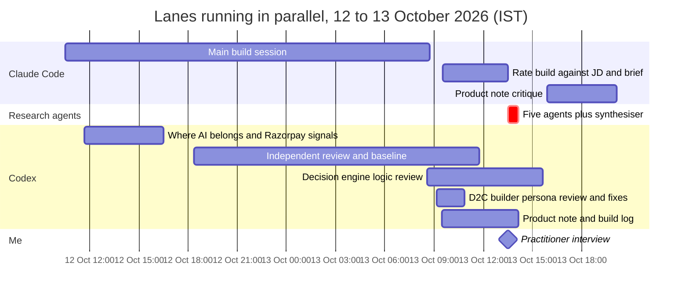

# Retention Agent AI Build Log

Razorpay x ISB AI PM Build Challenge | Track 2 | 13 October 2026

[Working prototype](https://smart-retention-razorpay.lovable.app/) | [Product overview](../README.md)

## At a glance

I ran this build as one product manager directing several AI lanes at once. Research questions ran in separate sessions and, for the evidence review, as five parallel agents. Claude Code built while Codex reviewed the work as an independent second model. I made the product calls: the merchant problem, persona, decision logic, economics, baseline and what to leave out. I also checked AI output against sources, tests and the rubric before anything shipped.

**What AI let one person ship in 15 days (29 September to 13 October)**

| Output | Volume | Speed |
| --- | --- | --- |
| Research | 199 web searches and 139 page reads in recorded Claude Code sessions; two long-form deep-research reports; a 97-record quote bank | The quote bank came from 5 parallel agents in 21 minutes, while I ran the practitioner interview |
| First hosted prototype | 30 scaffold commits from my approved brief | 43 minutes, 10:02 to 10:45 IST on 10 October |
| Working product | 22 commits I directed: campaign studio, decision engine, 4-strategy benchmark, guided tour, Razorpay Blade UI | 12 to 13 October |
| Data | Fictional Nira Botanics store with 18 product variants, 12,000 customers, 30,000 orders and 41,095 line items; app, CSV and SQLite from one seed | Generated and reconciled on 12 October |
| Verification | 27 automated tests across 8 files, TypeScript check, desktop (1440 px) and mobile (390 px) browser checks | Re-run and passing on 13 October, 20:45 IST |

**My three most consequential calls**

1. **I overruled the AI's first pick.** It recommended B2B invoice-blocker resolution because the AI role was easy to demonstrate. I changed the selection lens: *"'Why AI rather than a fixed rule?' This shouldn't be our core criteria."* Merchant importance and Razorpay's reach came first; AI fit came second. That led to D2C retention after the first order.
2. **I treated partners and competitors as signals, not vetoes.** The AI wanted to avoid overlap with partners such as BiteSpeed. I disagreed: *"I don't think that existing partner capabilities should drive our decision in any way, just inform…"* The product therefore competes on decisions and measured profit, not on another messaging tool.
3. **I fixed the measurement baseline.** I required the uplift to be measured against *"a merchant who does not have any retention product."* The Impact page, fee logic and benchmark were rebuilt around that baseline.

**Read by section:** [Tools](#1-tools-and-how-i-split-the-work) | [Orchestration](#2-how-i-orchestrated-the-work) | [Decisions](#3-research-and-product-decisions-i-directed) | [Outputs I rejected](#4-ai-outputs-i-rejected-or-corrected) | [Prototype](#5-from-product-decisions-to-the-working-prototype) | [Ownership](#6-what-ai-did-and-what-i-owned) | [Verification](#7-verification-limits-and-next-tests) | [Prompts](#8-selected-prompts-and-supporting-records)

## 1 Tools and how I split the work

| Tool | Model in session records | Role I gave it |
| --- | --- | --- |
| Claude Code | Opus 5.5, in every recorded session, including research agents | Research lanes, the multi-agent evidence review, the main build session on 12 to 13 October, browser verification, critique of the product note |
| Codex | GPT 6.1 Sol as the main model; GPT 5.6 Sol appears in some sessions | Brainstorming and opportunity selection, demo design, independent reviewer of the Claude Code build, early UI polish and later copy fixes |
| Lovable | Not recorded | Scaffold from my build brief, Git-connected preview and public hosting |
| ImageGen | Not recorded | One reusable botanical background for WhatsApp creative |
| Dean Peters' Product Manager Skills | Loaded in Claude Code and Codex | Storyboard, working-backwards press release and strategic document methods. I compared it with another public PM skill library before adopting it |

The prototype itself calls no live language, image or voice model. Runtime predictions, message drafting and ElevenLabs voice are simulated; see [Section 5](#5-from-product-decisions-to-the-working-prototype).

## 2 How I orchestrated the work

I used AI as a team of specialised lanes rather than one long chat. Each lane had one job, and I carried decisions between them.

| Pattern | What I did | Why it mattered | Evidence |
| --- | --- | --- | --- |
| **Parallel research lanes** | On 7 October I opened five Claude Code research sessions within 70 minutes, each with one question, such as a mental model of the brief, comparable studies, the revenue-recovery side and Magic Checkout's D2C merchants. Some ran at the same time | One context per question kept sizing, solution design and evidence from blurring together. I then asked for focused prompts per candidate (P06) | Session records; [research and narrowing](RESEARCH.md) |
| **Fan-out, fan-in research agents** | On 13 October I had Claude Code launch five research agents in parallel: beauty founders, food and apparel founders, operators and vendors, investors and surveys, and discount and attribution sceptics. A sixth agent merged their notes and graded every quote by how it was verified | 122 searches and 86 page reads in 21 minutes, while I conducted the practitioner interview. Each quote is graded: raw text read, fetched only, paraphrase or search snippet | [Quote bank](research/reports/D2C%20retention%20voices%20quote%20bank.md) and [agent notes](research/research_notes/D2C%20retention%20voices%20quote%20bank/) |
| **Builder and independent reviewer** | Claude Code built while Codex, a different model family, reviewed the result against the brief. I relayed findings between them. One example: the Codex review session is where I raised the no-retention-tool baseline (P20), and the Claude Code build implemented it that evening | A model does not grade its own work, so blind spots are less likely to be shared | Commit `1e6c651`; Codex and Claude Code session records |
| **Rubric-anchored red team** | I gave the AI the AI PM job description and the challenge brief, and asked it to rate the build as a Razorpay reviewer would. I also asked it to evaluate the build as *"a master product builder … in the D2C space"* and then fix what it found | The gaps it found became the evening fixes on 12 October: tour replay, a single fee baseline, merchant language and the no-tool baseline | [Implementation history](../BUILD_LOG.md) |
| **AI as sceptic** | *"You have to keep me realistic and be the voice of logic"* (P18) | The AI corrected my assumptions about what Razorpay's Vulcan model can and cannot know | [Section 5](#5-from-product-decisions-to-the-working-prototype) |
| **Persistent agent rules** | Architecture rules live in [`AGENTS.md`](../AGENTS.md). They began with the 10 October scaffold and were extended when the campaign studio landed. They cover pure decision modules, one shared state, data from a fixed seed, no network calls, persistence order and approval freezes | Every later Claude Code or Codex session inherited the same invariants. Screens could not drift apart on counts | `AGENTS.md` history, commit `d377bff` |
| **Spec before code** | A decision record, storyboard, press release and build brief were agreed before any build request | Lovable produced a hosted scaffold from the brief in 43 minutes, and later sessions changed behaviour rather than rediscovering intent | [Product decisions](PRODUCT_DECISIONS.md), [implementation plan](history/IMPLEMENTATION_PLAN.md) |
| **Automated browser verification** | After major changes, the AI drove the running app in a browser at desktop and mobile widths, running approve, send, pause, reset and setup flows | It caught real defects, such as the draft-overwrite race and an internal label shown to shoppers | [Section 7](#7-verification-limits-and-next-tests) |

### Parallel lanes during the build window

Bars span the first to the last recorded activity in each session, in IST.

### The research run that proved me partly wrong

I asked the agents to find D2C leaders saying that *acquisition is solved and profitable retention is the real problem*. The synthesised result did not support that claim as worded. Almost no named Indian leader says acquisition is solved. Most say CAC keeps rising, so profit must come from the repeat order, and Beco and Snitch push back directly. I narrowed the claim in the README and product note to a defensible version: acquisition is getting costlier, profit depends on repeat purchase, and most brands cannot tell which repeat orders their discounts caused. The agents also flagged that the discount-waste argument is made publicly mostly by vendors, and that Meta co-authored the main survey. Both caveats are disclosed.

## 3 Research and product decisions I directed

**Timeline:** market research from 28 September to 7 October; narrowing and the decision record on 7 to 8 October; the Lovable scaffold on 10 October; the campaign studio and data on 12 October; merchant experience, evidence and documents on 12 to 13 October.

### Choose the problem for merchant value, not for the AI demo

Prompts P01 to P05. I asked the AI to survey Razorpay's merchant segments and pain points before proposing anything. It generated four candidates: profit-aware cart recovery, blocked B2B collections, subscription recovery and post-purchase repeat-order decisions. It recommended B2B because the AI role was easy to demonstrate. I changed the criteria: *"'Why AI rather than a fixed rule?' This shouldn't be our core criteria."* The AI acknowledged it had over-weighted AI suitability.

With no internal Razorpay data, I directed the research to observable investment instead of invented market shares: *"It is not about inventing numbers."* Razorpay's [Sprint 2026 portfolio](https://razorpay.com/sprint/26) gives D2C its own track, and [Magic Checkout](https://razorpay.com/magic-checkout/) foregrounds D2C growth and COD controls. I treated this as an outsider's strategic hypothesis, not as evidence of revenue share. B2B remained plausible but less clearly reachable.

### Make research answer decision questions

Prompts P06 to P09. I asked for one concise deep-research prompt per candidate, and gave the AI a vetting role on the returned reports. Each prompt asked for the current workflow, evidence of pain, the strongest reason not to build and the cheapest validation test. When later reports were stronger, I had the first two candidates researched again before comparing them.

Review corrected several overreaches. Recovery results from other geographies don't transfer automatically. A customer's past purchases don't prove a discount was unnecessary. An undocumented competitor feature isn't proof the feature is absent. Faster collection of an existing invoice isn't new revenue.

### Read competitors and partners as signals

Prompts P10 to P12. I asked why partnerships exist when partners compete for the same merchants. The AI treated partner coverage, such as BiteSpeed, Klaviyo, LimeChat, GoKwik and Relo, as a reason to avoid overlap. I reframed it: partner coverage is a demand signal and the baseline to beat, not a veto. So I did not pitch retention, reorder timing or WhatsApp campaigns as new categories. The product competes on the decision itself: who to contact, what to offer, whether a discount pays, how payment risk changes the economics, and what profit was actually added.

### Pick the persona and test the story before coding

Prompt P13. I chose a mid-size Shopify D2C brand's growth or retention manager because it has product-level history, repeat potential and payment and delivery economics. [Agent Studio](https://razorpay.com/agent-studio/) already covers cart recovery, COD confirmation and feedback, so I chose the period after the first order. When the AI narrowed the product to body-care stores, I pushed back. The product stays configurable, and the demo uses one consumables brand to keep it coherent.

I used Dean Peters' `storyboard` and `press-release` skills to test the narrative. They raised the question that shaped the product: could a retention manager show finance what a campaign actually earned after discounts and failed deliveries?

### Add direct evidence and verify it at the source

I interviewed Vartika Mittal of NatHabit, who has D2C retention and growth experience, about the effort of building cohorts and campaigns with internal tools. AI helped organise my account. It did not conduct the interview, and I present it as a paraphrase, not as an endorsement.

I supplied the original DSGCP × Meta × ViralMint survey PDF. The AI read the chart pages and corrected two claims in my drafts: acquisition efficiency, not rising CAC alone, leads the growth-blocker chart, and the repeat-rate chart does not establish a 90-day window. Page references are in [the research evidence](RESEARCH.md#practitioner-interview-and-published-evidence).

## 4 AI outputs I rejected or corrected

| AI proposal or first output | My intervention | Result |
| --- | --- | --- |
| B2B invoice-blocker resolution, favoured for its clear AI role | Changed the selection criteria to merchant importance and Razorpay fit (P02 to P05) | The AI acknowledged the premature pick, and I chose D2C retention as an evidence-backed hypothesis |
| Partner coverage treated as a reason not to build | Reframed it as a demand signal and baseline (P10 to P12) | The product differentiates on decisions and measured profit |
| Offer estimates set per product, ignoring the customer's own history | Required customer-level records and asked where intelligence enters the workflow (P15 to P18) | Customer-level features now drive timing, offer and payment, and each decision is explained |
| Blade-*inspired* styling in the first scaffold | Asked for real Razorpay design language (P22) | The UI moved to actual Blade components and was re-checked on desktop and mobile |
| Drafts could be overwritten on reload | Specified persistent merchant drafts and templates (P21); AI review found the race | Saved state is now loaded before any write, with a regression test, and approval is tied to a frozen campaign revision |
| An internal payment label appeared in shopper WhatsApp text | Asked for a screen-by-screen plain-language pass (P23) | Shoppers see plain sentences, and the internal decision is stored separately |
| Comparison framed around competing strategies, not the merchant's starting point | Asked for the baseline to be a merchant with no retention tool (P20) | The Impact page leads with extra profit over no tool and what the merchant keeps after the fee; the 20% sale is secondary |

I also accepted corrections to my own assumptions. Payment-risk signals cannot establish causal discount response. Vulcan does not expose a merchant-wide shopping history. The research agents did not support my original retention claim as worded.

## 5 From product decisions to the working prototype

### Where intelligence belongs

Prompts P17 and P18. I asked where AI actually creates intelligence in the workflow. The answer split into four parts: Shopify history for products and rhythm, permitted Razorpay signals for payment and delivery risk, a retention model for timing and incremental response, and a language model for communication. The AI also corrected me: Vulcan is a payments foundation model, not a text LLM or a cross-merchant shopping database ([Razorpay's Vulcan explanation](https://razorpay.com/blog/vulcan-how-razorpay-built-a-foundation-model-for-payment-decisions/)).

| Responsibility | Proposed live product | This prototype |
| --- | --- | --- |
| Inputs | Connected orders, catalog, consent, payments, refunds and courier outcomes | One seeded synthetic history, with all connections simulated |
| Product and timing | Models rank products and estimate purchase windows | Rule-based selection and each customer's historical intervals |
| Offer response | Models calibrated with randomised experiments | Transparent customer-level formulas with stated priors |
| Decision and controls | Compare permitted actions on expected contribution; enforce consent, stock, margin and frequency rules | Simulated offer evaluation, a no-outreach option, approvals and pre-send checks |
| Communication | Product-grounded drafts and permitted voice follow-ups | Simulated text and call adapters; one ImageGen background combined with real catalog facts |
| Learning | Recalibrate from controlled outcomes | Outcomes update history and eligibility; recalibration is not implemented |

### Data, decision logic and economics

Prompts P14 to P16, P19 and P20. I replaced a generic everyday-essentials store with a coherent personal-care catalog, inspired by Mamaearth's product mix but using none of its data. The AI generated six months of realistic order history. The decision compares expected contribution with and without each permitted offer. A customer's discount history is shrunk toward a 25% prior worth three orders, so a single discounted order is weak evidence. "Reminder, no discount" and "don't contact" are first-class outcomes.

I proposed outcome pricing: *"the call and everything is a function of our cost, not theirs."* The illustrative fee is 25% of positive incremental contribution after losses offset wins. The operator pays for AI and messaging, and the merchant's numbers include discounts, product cost, fulfilment, returns and RTO.

The synthetic benchmark covers 90 days and the same 2,500 customers. Against no outreach, the agent added 7.2% to collected earnings before the fee and a blanket 20% sale added 0.3%. A zero-influence setting shows when the strategy loses money. These are synthetic results, not proof of live uplift.

### Merchant control, design and imagery

Prompts P21 to P24. I required drafts and templates to survive daily refreshes of recommendations. Approval freezes the campaign version, and material edits need reapproval. I asked for real Razorpay design language, an evaluator tour and plain merchant language. For imagery, ImageGen produced one background with the centre left empty. The app composes real products and approved prices on top, so the AI never invents commercial facts.

## 6 What AI did and what I owned

| Work | AI | Me |
| --- | --- | --- |
| Opportunity selection | Generated and compared candidates | Changed the selection lens; rejected the B2B pick |
| Research | Wrote focused prompts, ran parallel agents, synthesised and graded sources | Set the questions, read key sources, accepted that my claim was disproved |
| Product definition | Proposed workflows, alternatives and constraints | Chose persona, scope, controls and acceptance criteria |
| Interview | Organised my account | Conducted it |
| Economics | Built contribution and comparison logic | Set outcome pricing, operator-paid delivery and the no-tool baseline |
| Code, data, tests | Wrote and revised most of it | Specified behaviour, set architecture rules, reviewed screens and state |
| Verification | Ran tests and browser walkthroughs, diagnosed and fixed defects | Challenged mismatches and decided what to disclose |

AI wrote most of the code and generated the data, tests and background. My contribution was direction, evidence judgment, specification, orchestration and review.

## 7 Verification, limits and next tests

**Fresh check on 13 October, 20:45 IST:** 27 tests across 8 files passed and the TypeScript check was clean. Earlier recorded checks covered approval, invalidation, sending, pausing, resetting, responsive screens and CSV and SQLite reconciliation.

Defects caught through AI-assisted review and fixed:

- A reload race could overwrite saved drafts. Saved state now loads before any write, and a remount regression test was added.
- Audiences were capped by customer ID. They are now ranked by expected additional contribution first.
- Experiment controls were not reserved across campaigns. Treatment and control customers are now reserved, and skipped customers stay in the treatment group's denominator.
- Fee baselines, labels and exports disagreed. They now use one baseline, late refunds adjust once, and losses offset wins.
- Replaying the tour could break an existing campaign. It now opens a fresh draft without deleting saved work.
- An internal payment label leaked into shopper messages. It was replaced with plain language.

**Limits:**

- **Validation:** one practitioner interview; how widespread the problem is, and whether merchants would adopt the product, are untested.
- **Intelligence:** response estimates are deterministic assumptions, with no learned model.
- **Integrations:** store, payments, risk, messaging and calls are simulated. No real customer is contacted.
- **Outcome proof:** synthetic results do not establish causal uplift.
- **Operations:** state is stored only in the browser.
- **Strategy:** whether offering this to merchants on other payment providers moves them to Razorpay is a hypothesis to test.

**Next:** more merchant interviews, then a randomised pilot measuring extra collected profit per eligible customer, what the merchant keeps after the fee, and time saved preparing campaigns.

## 8 Selected prompts and supporting records

These are verbatim excerpts, conversational grammar included. Most are my own instructions; P08, P09 and P24 are AI-assisted prompts used in the workflow. They are curated excerpts, not full transcripts, and contain no customer data or credentials.

**P01 · My instruction: explore merchant problems first**
> But you would think about various customer that Razorpay serves, where things can be built - like mutiple pain points and then you build for the most impactful?

**P02 · My instruction: investigate segments before recommending**
> Can we start with finding how's the current razorpay customer share is split - like how much D2C business, how much SaaS Business, how much educational business and how these share are growing?

**P03 · My correction: change the selection criteria**
> I feel "Why AI rather than a fixed rule?" This shouldn't be our core criteria

**P04 · My instruction: use visible product investment as evidence**
> What I was thinking is that we can also take a look at Razorpay's website and offer to get a sense of what their more lucrative or prominent segment is, because they must be building a lot for them. That could be one.

**P05 · My constraint**
> It is not about inventing numbers.

**P06 · My instruction: one focused prompt per candidate**
> What I can do is start deep research, but you have to give me four prompts for each of them. Ensure that the prompts themselves are concise.

**P07 · My instruction: AI as reviewer of returned research**
> You don't need to do it yourself, you can vet, check for inconsistency or doubt and build over it, but v1 I will get you - you just give me the prompt.

**P08 · AI-assisted research prompt**
> Could cohort-level experimentation improve decisions without claiming individual counterfactual prediction?

**P09 · AI-assisted research prompt**
> Return an evidence table, a testable problem hypothesis, the strongest reason not to build, and the cheapest validation test.

**P10 · My instruction: the commercial logic of partnerships**
> Look for other such partnerships and go a level down to understand why that partnership could exist in the very first place, because they're fighting for the same segment of merchants.

**P11 · My correction: partners inform, they don't veto**
> I don't think that existing partner capabilities should drive our decision in any way, just inform in terms of what the market is demanding and where we lag in current state.

**P12 · My correction: competitor activity is a demand signal**
> It is some sort of signal for us, not just inspiration.

**P13 · My scope challenge**
> Also, why are we narrowing to body care consumable shops, but not taking a very high level, like a broader solution for offering retention and retention stack sort of stuff?

**P14 · My data brief: a coherent catalog**
> Let's change "everyday essential" to "some cosmetic store" or something like that, and have a consistent product. Take inspiration from Mama Earth so that you have a good variety of products and a good product mix and match.

**P15 · My data brief: volume**
> Create a database of, say, orders done over the last 6 months, with 5K orders per month as the average.

**P16 · My data brief: inspectable records**
> it should show individual order, customer ID level, product mix, and all that stuff that Shopify would be doing.

**P17 · My question: where intelligence enters**
> Also, at what point would the AI be used in this whole workflow to build intelligence?

**P18 · My review instruction: AI as sceptic**
> Again, this is me being the dreamer. You have to keep me realistic and be the voice of logic.

**P19 · My commercial direction**
> Also, how do you think we sell it on an outcome basis? In that case, the call and everything is a function of our cost, not theirs.

**P20 · My measurement direction**
> Also, shouldn't you think that, in the measurement of the uplift, it should be compared with the baseline for a merchant who does not have any retention product versus what this retention product would deliver for them?

**P21 · My workflow requirement**
> I think we would have to also think about the states where the merchant makes something of their own and that stays in a templateized format (let's say, as in a draft format) so that they can come and work again.

**P22 · My design instruction**
> Check for that as well so that it feels like it is designed for Razorpay.

**P23 · My communication requirement**
> whatever we are showing on the screen should be easy to read as well as self-explanatory in nature.

**P24 · ImageGen prompt used during the build**
> Keep the central 60 percent calm and empty to receive verified product cards and personalized offer text composited by the application. No product packaging, no people, no medical claims, no words, no logos, no prices, no coupons, no watermark. This is a background asset rather than a screenshot or UI mockup.

### Supporting records

- [Product overview and reviewer walkthrough](https://github.com/akshatj28/razorpay-retention-agent/blob/main/README.md)
- [Research and candidate narrowing](https://github.com/akshatj28/razorpay-retention-agent/blob/main/docs/RESEARCH.md)
- [Multi-agent quote bank (97 graded records)](https://github.com/akshatj28/razorpay-retention-agent/blob/main/docs/research/reports/D2C%20retention%20voices%20quote%20bank.md)
- [Persistent agent rules (AGENTS.md)](https://github.com/akshatj28/razorpay-retention-agent/blob/main/AGENTS.md)
- [Dated implementation and verification history](https://github.com/akshatj28/razorpay-retention-agent/blob/main/BUILD_LOG.md)
- [Product decisions and integration boundaries](https://github.com/akshatj28/razorpay-retention-agent/blob/main/docs/PRODUCT_DECISIONS.md)
- [Image prompt and provenance](https://github.com/akshatj28/razorpay-retention-agent/blob/main/docs/CREATIVE_ASSETS.md)
- [Synthetic data dictionary](https://github.com/akshatj28/razorpay-retention-agent/blob/main/data/nira/README.md)
