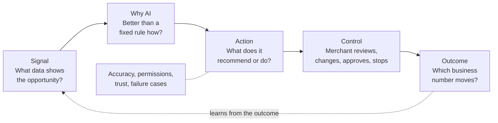
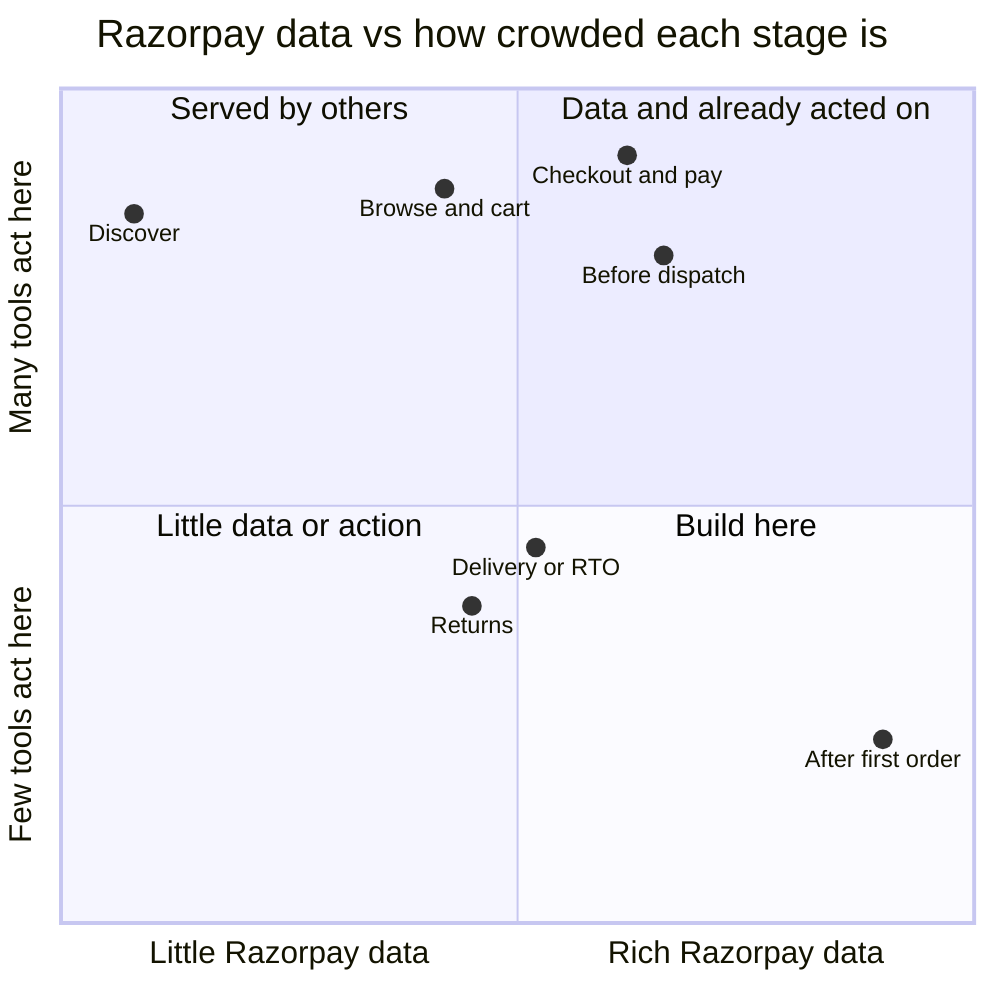
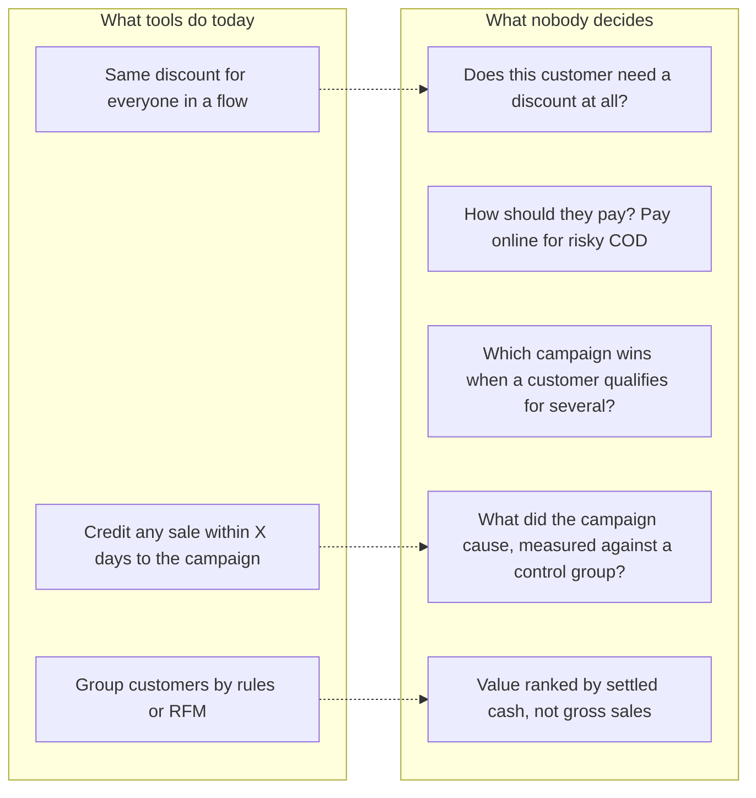

# Research and narrowing

How we went from the Track 2 brief to a repeat-purchase decision agent: the personas and journey stages we considered, the ideas we tested and dropped, what merchants say hurts, and where the numbers come from.

Research ran from 28 Sep to 8 Oct 2026. Market figures are mostly **vendor-reported or from industry blogs**, and they're labelled that way. **No merchant interviews have been done yet.** The persona is a proto-persona, and section 6 lists how we'd validate it.

---

## 1. What the brief asks for

Track 2 describes a closed loop, and any idea has to answer every box:

Not allowed: a generic chatbot, or a dashboard that only explains information.

## 2. How we narrowed down

### 2.1 Four filters

1. **Razorpay already has the data.** Magic Checkout captures the phone number (OTP), cart, payment method and COD/RTO history.
2. **It's a money decision that changes per customer**, so AI beats a rule.
3. **Razorpay or a direct competitor doesn't already ship it.**
4. **There are enough orders to prove impact against a control group.**

### 2.2 Personas

| Persona | Situation | Decision |
|---|---|---|
| Subscription / SaaS merchant | Loses revenue to failed renewals | Dropped. Razorpay's Subscription Recovery agent covers it |
| Large enterprise merchant | Has account managers and data teams | Dropped. Least need |
| Small long-tail merchant | No account manager, low volume | Dropped. Too few orders to decide per customer or run a control group |
| **Mid-size D2C on Magic Checkout** | Heavy COD, low repeat rate, discounts everyone at sale time | **Picked** |
| End shopper | Receives offers and pays | Secondary user, not the buyer |

Only the mid-size D2C merchant passes all four filters, and only at one journey stage: **after the first order**.

### 2.3 The journey, and who already serves each stage

| Stage | What Razorpay sees | Existing tools | Published results (vendor-reported) |
|---|---|---|---|
| Discover | Nothing first-party | Meta, Google, creators | CAC up 22–35% in two years |
| Browse & cart | Cart + phone (Magic Checkout) | Razorpay abandoned-cart agent, GoKwik, BiteSpeed, KwikEngage | 13–22% of WhatsApp cart flows convert |
| Checkout & pay | Payment method, failure code, RTO score | Magic Checkout, GoKwik, Shopflo, payment retry, Vulcan routing | Checkout conversion +5% to +50%; 15–20% of failed payments recovered |
| Before dispatch | COD orders and risk | RTO Shield, COD confirmation agent, GoKwik, Shiprocket Engage+ | RTO down 15–46% |
| Delivery / RTO | RTO outcome if shared | Shiprocket, ClickPost | COD RTO 25–30% vs 2–3% prepaid |
| Returns | Refunds and reasons | Return Prime, instant refunds | Up to 21% of return value kept via exchange |
| Use, between orders | What was bought, size, price, payment, returns | Generic post-purchase flows, reminder apps | No India data found |
| **Reorder & win-back** | **Recency, frequency, spend, COD vs prepaid, settled cash** | BiteSpeed (Razorpay partner), LimeChat, Interakt, MoEngage, Klaviyo, loyalty apps | **Reported as attributed revenue; none against a control group** |

*The positions are our qualitative judgment, not measured values.*

### 2.4 Ideas we tested

| Idea | Outcome | Why |
|---|---|---|
| Occasion-led reorder offers | **Became the core** | Open stage; Razorpay owns the payment step and COD/RTO data. Widened into the full repeat-purchase agent |
| COD → prepaid before dispatch | **Folded in** as the payment decision | Scored highest, but RTO Shield and COD confirmation already ship. Kept as a pay-online nudge for risky COD customers |
| Cash-truth ROAS | Explored | Only the payment layer sees settled cash per campaign, but it's hard to demo as an *action* |
| Failed-payment / abandoned-cart recovery | Parked | Largest pools, but Razorpay ships its own agents and 5+ vendors compete |
| Refund → exchange | Runner-up | Partly served by Return Prime |
| Voice account manager | Folded in as a channel | Calling is a commodity; useful only for high-value customers who don't respond |
| Network-enriched offers | v2 | Needs cross-merchant consent under DPDP |
| Cross-merchant ad network, lending | Rejected | Breaks Razorpay's processor role; regulated |
| "BiteSpeed inside Razorpay" (full CRM) | Rejected | BiteSpeed became a Razorpay partner on 16 Jun 2026. We decide; messaging is a channel |
| Fixed 30/60-day reorder campaigns | Replaced | A fixed delay is a rule, and Klaviyo and LimeChat already offer it. The agent uses each customer's own rhythm |

**Demo category.** The demo leads with skincare and haircare because a replenishment rhythm is easiest to see there. The same engine covers categories without a fixed cycle (for example fashion) through "past their usual gap" and merchant-started campaigns.

## 3. What tools do today vs what nobody decides

| Campaign every tool offers | How it's set today |
|---|---|
| Reorder / replenishment | Fixed delay; Klaviyo offers a predicted next-order date |
| Win-back | No purchase in 60/90/120 days, plus a discount |
| Festive / sale broadcast | Merchant schedules it; same discount for all |
| Post-purchase cross-sell | Fixed delay after delivery |

**Timing is not our claim.** Klaviyo already predicts the next order date. Our claim is the per-customer offer and payment decision, and proving the result against a control group.

## 4. Merchant pain: what Indian D2C sellers say hurts (2025–26)

| # | Pain point | Evidence | Does Retention Agent address it? |
|---|---|---|---|
| 1 | Customer acquisition cost | Biggest growth blocker in a 100+ founder survey; 70%+ rely on Meta | **Indirectly.** A second order recovers the ₹800–1,200 spent to acquire the customer |
| 2 | Discount spend and profit | Stacked discounts reach 25–30% of revenue; founders say discounting did long-term harm | **Directly.** No discount for customers who would buy anyway |
| 3 | COD and RTO | 30–60% of website orders are COD | **Partly.** Pay-online nudge for medium/high-risk COD customers |
| 4 | Low repeat purchase | 20–30% buy again within 90 days; 55% under-invest in retention | **Directly** |
| 5 | Own site losing share to quick commerce | 18–35% commission on quick commerce | **Partly.** Repeat orders on the brand's own site |

**What this changed in the pitch:** repeat purchase is a known problem, but it's not the one founders name first. So we lead with **discount waste and the finance question** ("what did that discount actually earn?") and present repeat orders as the way to fix acquisition cost and discount spend together.

### Why measuring against a control group matters

Messaging tools report *attributed* revenue. If a loyal customer was going to reorder on Tuesday and gets a 10% code on Monday, the campaign takes credit for the sale and the merchant loses 10% margin on an order that would have happened anyway. A control group (eligible customers who get no message) is the only way to separate what the campaign caused from what it took credit for. This is why the product reports extra profit against a control group and treats attributed sales as information, not proof.

## 5. Regulatory and trust constraints

| Area | Constraint | How the design responds |
|---|---|---|
| DPDP Act 2023 | Profiling for marketing needs explicit, informed consent | Uses the merchant's own customer data; no cross-merchant offers in v1; separate consent per channel |
| TRAI commercial communication rules | Promotional messages need opt-in and registered templates | Reorder nudges are treated as promotional; opt-outs honoured before every send |
| WhatsApp Business pricing | Marketing messages cost about ₹0.86 each in India (2026) | Each message has a cost in the decision; "don't contact" is a valid choice |
| Razorpay's role as payment aggregator | Settlement must stay separate from marketing risk | Network signals are used only for payment/delivery risk, never to infer discount sensitivity |
| Pricing fairness | Opaque personalised pricing breaks trust | Offers come only from merchant-approved discount levels within a cap; every decision shows its reason |

## 6. Open questions and how we'd validate

| # | Open item | Next step |
|---|---|---|
| 1 | **The persona isn't validated** | 3–5 interviews with D2C growth managers (questions below) |
| 2 | Two sizing approaches disagree on reorder value (≈₹0.6 Cr vs ₹2–4 Cr a year for a ₹90–100 Cr brand) | One model from sourced inputs: repeat rate, order value, discount share, expected lift |
| 3 | Response to discounts is assumed, not learned | Run a pilot with randomised discount levels and a control group, then fit uplift by segment |
| 4 | The Razorpay RTO signal adds little in our simulation (it mostly changes payment treatment) | Check with real RTO data. The stronger Razorpay advantage may be settled-cash truth and distribution through the dashboard merchants already use |
| 5 | Product picks need catalog data Razorpay doesn't own | Assume Shopify catalog access; keep product choice rule-based in v1 |

**Interview questions** (about past behaviour, not opinions):

1. Which three numbers did you review last week, and which worried you most?
2. In your last festive sale, who got a discount, and how did you decide?
3. How do you tell whether a WhatsApp campaign caused a sale or just took credit for it?
4. What share of orders is COD, and who handles RTO?
5. What did you spend on retention in the last six months, and did that go up or down?

## 7. Key numbers we use

| Number | Source type |
|---|---|
| 70–80% of first-time D2C buyers don't buy again within 90 days | Industry blogs and founder surveys |
| ₹800–1,200 to acquire a beauty / personal-care customer | Clickpost blog |
| 55% of founders under-invest in retention; 70%+ rely on Meta | DSGCP × Meta × ViralMint founder survey (Dec 2025) |
| COD RTO 25–30% vs 2–3% prepaid | Logistics vendor blogs |
| Magic Checkout case studies: conversion +5% to +110%, RTO down up to 75% | Razorpay published case studies (vendor-reported) |
| BiteSpeed × Razorpay partnership, 16 Jun 2026 | PTI press release |

## 8. Sources

**Razorpay**
- [Agent Studio launch](https://razorpay.com/newsroom/razorpay-launches-the-worlds-first-ai-native-agent-studio-for-payments-at-ftx26-powered-by-anthropics-claude/) · [Agent Studio principles, guardrails and merchant control](https://razorpay.com/blog/razorpay-agent-studio-principles-guardrails-and-merchant-control/)
- [Vulcan: a foundation model for payment decisions](https://razorpay.com/blog/vulcan-how-razorpay-built-a-foundation-model-for-payment-decisions/)
- [Magic Checkout RTO intelligence docs](https://github.com/razorpay/markdown-docs/blob/master/payments/magic-checkout/rto-intelligence.md)
- [Failed payment recovery](https://razorpay.com/blog/razorpay-failed-payment-recovery/)
- Magic Checkout D2C case studies, e.g. [FAE Beauty](https://razorpay.com/blog/fae-beautys-journey-magic-checkout-case-study/), [Root Deep](https://razorpay.com/blog/magic-checkout-case-study-root-deep/), [Isak](https://razorpay.com/blog/magic-checkout-case-study-isak/), [Cookd](https://razorpay.com/blog/magic-checkout-case-study-cookd/)

**Competitors and partners**
- [BiteSpeed](https://www.bitespeed.co/) · [BiteSpeed × Razorpay (PTI)](https://www.tribuneindia.com/news/business/bitespeed-partners-with-razorpay-to-launch-unified-ai-conversion-and-retention-stack-for-d2c-brands-2-2/) · [BiteSpeed funding](https://india.entrepreneur.com/news-and-trends/bitespeed-raises-usd-35-mn-funding-led-by-peak-xvs-surge/482896)
- [GoKwik × Honasa](https://www.cxodigitalpulse.com/?p=35818) · [GoKwik RTO savings 2023](https://cxotoday.com/media-coverage/gokwik-has-helped-ecommerce-brands-save-over-rs-130-cr-worth-of-rto-losses-in-2023/) · [Shopflo case studies](https://www.shopflo.com/customers/gunam-beauty) · [Return Prime](https://apps.shopify.com/return-prime)
- [Klaviyo flows guide](https://help.klaviyo.com/hc/en-us/articles/115002774932-Guide-to-flows) · [Klaviyo expected date of next order](https://community.klaviyo.com/marketing-30/create-a-replenishment-flow-using-predictive-analytics-expected-date-of-next-order-19085) · [Klaviyo campaign workflow](https://help.klaviyo.com/hc/en-us/articles/115005054847) · [Klaviyo attribution](https://help.klaviyo.com/hc/en-us/articles/115005248128) · [LimeChat store notifications](https://docs.limechat.ai/re-engagement/store-notifications)

**Market and merchant pain**
- [DSGCP: Zero to 100 Cr marketing playbook](https://www.dsgcp.com/insights/zero-to-100-cr---marketing-playbook) · [Entrepreneur India: why D2C brands stall before ₹100 Cr](https://www.entrepreneur.com/en-in/news-and-trends/why-most-indian-d2c-brands-fail-to-cross-inr-100-crore-mark/500862)
- [Clickpost: D2C brands in India 2026](https://www.clickpost.ai/blog/d2c-brands-in-india) · [Clickpost: RTO reduction tools](https://www.clickpost.ai/blog/rto-reduction-tools)

**Data model**
- [Shopify Admin GraphQL `Order` object](https://shopify.dev/docs/api/admin-graphql/latest/objects/Order): order, customer and line-item structure, and the default 60-day order access
