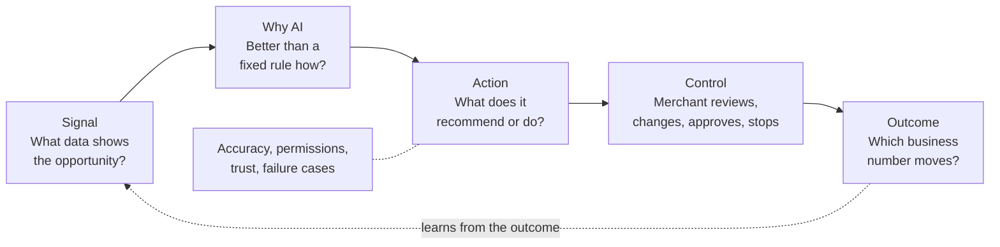
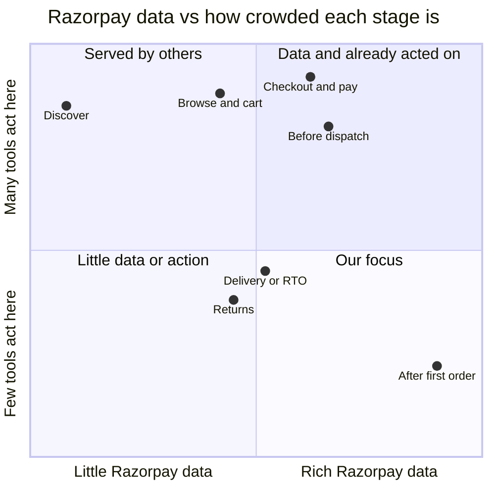
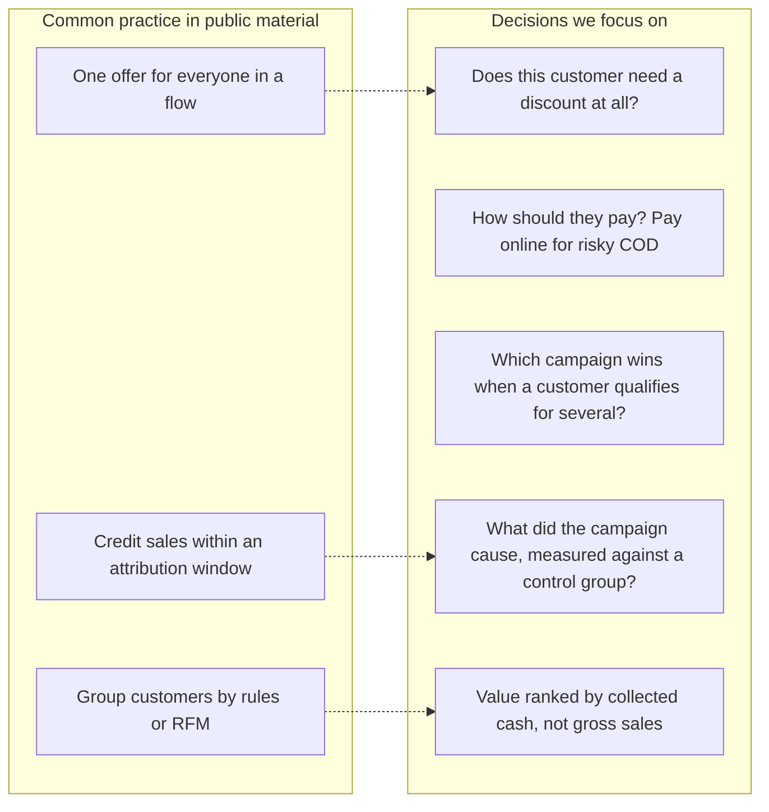

# Research and narrowing

How we went from the Track 2 brief to a repeat-purchase decision agent: the candidates, personas and journey stages we considered, the ideas we tested and left out, what merchants report as painful, and where the numbers come from.

The initial public research ran from 28 Sep to 8 Oct 2026. During final drafting I also added an interview with Vartika Mittal of NatHabit, whose experience includes D2C retention and growth. Her account supports the campaign-preparation and customer-level-intelligence problem; it does not establish its prevalence or the product's impact. Market figures are mostly vendor-reported or secondary-source findings and are labelled accordingly. Competitors and partners inform demand and the current baseline, rather than proving that a capability is absent or ruling out an idea. The [AI build log](AI_BUILD_LOG.md) records how this reasoning was challenged and revised.

---

## 1. What the brief asks for

Track 2 describes a closed loop, and any idea has to answer every box:

Not allowed: a generic chatbot, or a dashboard that only explains information.

## 2. How we narrowed down

### 2.1 Candidates and decision checks

We compared four candidate problems: profit-aware abandoned-cart recovery, blocked B2B collections, contextual subscription recovery and post-purchase repeat-order decisions. An early AI recommendation favoured B2B collections because it gave AI a clear role. That recommendation was challenged: merchant impact and Razorpay's strategic fit had to lead the selection, with AI suitability assessed afterwards.

Our final decision checks were:

1. **Merchant importance and strategic fit.** Is the job economically meaningful for an audience Razorpay could reach?
2. **Data and action feasibility.** Which signals exist, which need integrations or permission, and what can the merchant actually act on?
3. **Improvement over the current workflow.** Competition and partnerships inform demand and the baseline; overlap does not automatically rule out an idea.
4. **Measurable value and justified AI.** Can an experiment test contribution gains, and would learned estimates improve on a suitable rules baseline?

### 2.2 Personas

| Persona | Situation | Decision |
|---|---|---|
| Subscription / SaaS merchant | Loses revenue to failed renewals | Dropped. Razorpay's Subscription Recovery agent already covers it |
| Large enterprise merchant | Often has account managers and data teams | Deprioritised for v1. We hypothesised more existing analytical support and a harder initial workflow; this is not a claim that enterprises lack retention pain |
| Small long-tail merchant | Lower order volume | Deprioritised for v1. Low volume can make per-merchant experiments and economics harder; real feasibility needs a sample-size and variance check |
| **Mid-size Shopify D2C brand, initially on Magic Checkout** | COD exposure, repeat-purchase potential, broad offers at sale time | **Picked as the starting hypothesis** |
| End shopper | Receives offers and pays | Secondary user, not the buyer |

The mid-size D2C brand gave the most coherent starting hypothesis: product-level purchase history, repeat-purchase potential and payment/delivery economics could support an actionable retention workflow. We chose **the period after the first order** as a focused extension to investigate, rather than reproducing a recovery agent Razorpay already showcases. This is a product choice informed by public research, not a validated ranking of Razorpay's personas.

### 2.3 The journey, and who already serves each stage

| Stage | What Razorpay sees | Existing tools | Published results (vendor-reported) |
|---|---|---|---|
| Discover | Nothing first-party | Meta, Google, creators | CAC up 22–35% in two years |
| Browse & cart | Cart + phone (Magic Checkout) | Razorpay abandoned-cart agent, GoKwik, BiteSpeed, KwikEngage | 13–22% of WhatsApp cart flows convert |
| Checkout & pay | Payment method, failure code, RTO score | Magic Checkout, GoKwik, Shopflo, payment retry, Vulcan routing | Checkout conversion +5% to +50%; 15–20% of failed payments recovered |
| Before dispatch | COD orders and risk | RTO Shield, COD confirmation agent, GoKwik, Shiprocket Engage+ | RTO down 15–46% |
| Delivery / RTO | RTO outcome if shared | Shiprocket, ClickPost | COD RTO 25–30% vs 2–3% prepaid |
| Returns | Refunds and reasons | Return Prime, instant refunds | Up to 21% of return value kept via exchange |
| Use, between orders | What was bought, size, price, payment, returns | Generic post-purchase flows, reminder apps | No India data found |
| **Reorder & win-back** | **Store product history plus connected payment, refund and delivery outcomes** | BiteSpeed (Razorpay partner), LimeChat, Interakt, MoEngage, Klaviyo, loyalty apps | **Mostly reported as attributed revenue; we found few public results against a control group, though enterprise platforms support them** |

*The positions are our qualitative judgment, not measured values.*

### 2.4 Ideas we tested

| Idea | Outcome | Why |
|---|---|---|
| Post-purchase repeat-order decisions | **Became the core** | Combines product history with payment, COD and refund outcomes, and leads to a concrete merchant decision. Widened from occasion-led offers into the full repeat-purchase agent |
| Blocked B2B collections (acceptance evidence, invoice/PO mismatches) | Not chosen | Initially recommended for its clear AI role. After re-ranking on merchant importance and strategic fit, its fit with the reachable merchant base was less established in our research. It remains a plausible opportunity |
| Contextual subscription recovery | Not chosen | Razorpay's Subscription Recovery agent already addresses the core job |
| COD → prepaid before dispatch | **Folded in** as the payment decision | Scored highest, but RTO Shield and COD confirmation already ship. Kept as a pay-online nudge for risky COD customers |
| Cash-truth ROAS | Explored | Only the payment layer sees settled cash per campaign, but it's hard to demo as an *action* |
| Failed-payment / abandoned-cart recovery | Parked | Largest pools, but Razorpay ships its own agents and 5+ vendors compete |
| Refund → exchange | Runner-up | Partly served by Return Prime |
| Voice account manager | Folded in as a channel | Calling is a commodity; useful only for high-value customers who don't respond |
| Network-enriched offers | Later, if permitted | Would need separate cross-merchant consent under DPDP |
| Cross-merchant targeting, ad network, lending | Left out | Broader data permissions and operational scope than this prototype; risk enrichment is separate from marketing targeting |
| A full CRM ("BiteSpeed inside Razorpay") | Left out | Focused the prototype on decisions, controls and contribution measurement. Existing vendors and partners (BiteSpeed has partnered with Razorpay since Jun 2026) inform the benchmark, rather than vetoing a native improvement |
| Fixed 30/60-day reorder campaigns | Replaced | A fixed delay is a rule, and Klaviyo and LimeChat already offer it. The agent uses each customer's own rhythm |

### 2.5 Deep-research reports

Two long-form deep-research reports were run with focused prompts and then source-checked before any direction was chosen:

| Report | What it covered | What we took from it |
|---|---|---|
| *AI-native growth and revenue recovery for payment platforms* | Global landscape (smart retries, recovery SaaS, conversational AI), case studies, a use-case matrix, India's regulatory brief (TRAI 140/1600 series, DPDP, WhatsApp pricing), product patterns and failure modes | Failed-payment and COD recovery are proven but crowded and already shipped by Razorpay. Promotional outreach in India carries real compliance and cost constraints |
| *Feasibility of AI-personalised reorders using payment-platform data* | Razorpay's ecosystem and its proactive gap, predictive-commerce case studies, incrementality, timing and pricing research, data reality, DPDP/RBI/TRAI constraints, design patterns, a worked D2C example | Measure against a control group; prefer reminders and timing over deep discounts; anchor in the checkout layer; keep v1 to one merchant's first-party data |

Findings that changed the design:

- **Attribution flatters retention tools.** If a loyal customer was going to reorder anyway, a 10% code just gives away margin while the campaign takes credit. → A control group in every campaign.
- **Discounts train customers to wait.** Reminder-led replenishment tends to hold more long-term value than deep discounting. → "Reminder, no discount" is a first-class option.
- **A payment gateway alone is blind to items.** The advantage comes from checkout integration plus store catalog data. → Shopify product history plus Razorpay payment outcomes.
- **Cross-merchant pooling is a legal and trust risk.** → Single-merchant decisions; network signals used for payment risk only.
- **Messages cost money.** At about ₹0.86 per WhatsApp marketing message, contacting low-probability customers destroys ROI. → Cost is part of every decision, and "don't contact" is allowed.
- **Opaque personalised pricing risks backlash.** → Only merchant-approved discount levels within a cap, and every decision shows its reason.

**Demo category.** The demo leads with skincare and haircare because a replenishment rhythm is easiest to see there. The same engine covers categories without a fixed cycle (for example fashion) through "past their usual gap" and merchant-started campaigns.

## 3. What tools typically do, and the gap we investigate

| Common campaign | How it's typically set |
|---|---|
| Reorder / replenishment | Fixed delay; Klaviyo offers a predicted next-order date |
| Win-back | No purchase in 60/90/120 days, plus a discount |
| Festive / sale broadcast | Merchant schedules it; same discount for all |
| Post-purchase cross-sell | Fixed delay after delivery |

Some platforms, especially enterprise engagement platforms, already support richer targeting, predictive timing and control groups. The diagram shows where this prototype concentrates, not capabilities that no tool offers.

### 3.1 Retention tool landscape

| Category | Examples | What it decides | How results are usually reported |
|---|---|---|---|
| Customer engagement platforms | CleverTap, MoEngage, WebEngage, Netcore, Klaviyo | Predictive segments (likely to buy, churn risk), product recommendations | Attributed revenue; enterprise plans also support control groups and AI offer selection |
| WhatsApp CRMs for Shopify | BiteSpeed, Interakt, AiSensy, Wati | Which flow a customer enters; mostly rules set by the marketer | Attributed revenue (e.g. "3x repeat orders") |
| Checkout + engagement | GoKwik KwikEngage, Shiprocket Engage 360 | Who to nudge; RTO risk | Attributed revenue, RTO reduction |
| Loyalty | Razorpay Engage, Nector, Flits | Earn-and-burn rules; nothing per customer | Points redeemed |
| On-site bundles | Rebuy, Shopify bundle apps | Which bundle to show, on the website only | On-site conversion |
| Razorpay + BiteSpeed (Jun 2026) | Magic Checkout + BiteSpeed AI CRM | Checkout identity feeding CRM campaigns | As for WhatsApp CRMs |

| Gap | Typical today | Retention Agent |
|---|---|---|
| Who gets a discount | The whole segment gets the same code | Per-customer choice, including no discount |
| Payment step | The message links to the site | A pay-online nudge for medium/high-risk COD buyers |
| Proof | Attributed revenue | Extra contribution against a control group, after discounts, RTO and refunds |
| Pricing | Monthly SaaS fee (BiteSpeed is reported at roughly ₹15–30K a month) | Illustrative: a share of positive extra contribution |

**A correction this research forced:** an earlier draft said Razorpay had no retention product. That was wrong, because Razorpay Engage and the BiteSpeed partnership exist. The defensible claim is narrower: no tool we found combines payment-side outcomes, margin-aware per-customer offers and contribution measurement for mid-size D2C brands. The biggest threat is GoKwik or Shiprocket adding this decision layer to the checkout, RTO and WhatsApp data they already hold.

**Timing is not our claim.** Klaviyo already predicts the next order date. Our claim is the per-customer offer and payment decision, and proving the result against a control group.

## 4. Merchant pain: what Indian D2C sellers report (2025–26)

### Practitioner interview and published evidence

**Direct research:** I interviewed Vartika Mittal of NatHabit. She described the time spent using internal tools to define cohorts and build retention campaigns, the difficulty of producing customer-level intelligence, and why retention receives attention when acquisition costs are high. This is my paraphrase of the interview, supplied during final drafting. It is not a verbatim transcript, an endorsement or a measured time-saving result. Her experience includes D2C retention and growth; I am not presenting that earlier role as her current job title.

**Survey context:** I inspected the original DSGCP × Meta × ViralMint playbook PDF supplied during final drafting on 13 October 2026. Its survey architecture describes 100+ early- to mid-scale D2C brands across beauty, personal care, food, apparel, healthcare and home (printed p. 19; PDF page 20). The summary reports 70% citing CAC/ROAS inconsistency and 55% under-investing in CRM/retention (printed p. 46; PDF page 47). The repeat-purchase chart places 11.4% in the 10–20% band and 42.9% in the 20–30% band, totalling 54.3%; it does not specify a common measurement window or establish a 90-day repeat rate (printed p. 31; PDF page 32). These findings describe the sample, not all Indian D2C brands. [Publisher and report download](https://www.dsgcp.com/insights/zero-to-100-cr---marketing-playbook)

**Wording correction:** the growth-blocker chart ranks acquisition efficiency first at 38%, followed by retention/loyalty at 22% (printed p. 40; PDF page 41). The same page's prose says over half identify acquisition-related problems as their biggest blocker, without explaining how that relates to the chart. I therefore avoid stating that rising CAC alone is the number-one blocker or quoting a combined percentage from this page. The 70% CAC/ROAS finding above is the clearer statistic for the one-pager.

| Published practitioner statement | Verified attribution and date | Implication and limit |
| --- | --- | --- |
| ROAS does not establish sustainable or profitable growth; Fixderma also considers contribution and repeat behaviour | Shaily Mehrotra, CEO and Co-Founder, Fixderma; 25 August 2026 | Supports contribution measurement; not proof that every retention campaign loses margin. [Source](https://www.exchange4media.com/marketing-news/d2c-brands-look-beyond-roas-as-rising-cac-puts-profitability-under-the-lens-157597.html) |
| Traya can accept first-order losses when the 12-month cohort becomes profitable | Saloni Anand, Co-Founder, Traya Health; 9 April 2026 | Supports cohort economics; not a universal claim about first-order payback. [Source](https://inc42.com/buzz/mumbai-edition-of-d2cx-converge-decodes-the-%E2%82%B9100-cr-playbook-for-d2c-brands/) |
| Digital acquisition costs were rising, and repeats and lifetime value matter | Dhruv Toshniwal, CEO, The Pant Project; 13 February 2024 | Historical evidence of the pressure; not a current numerical CAC benchmark. [Source](https://www.exchange4media.com/digital-news/digital-cac-on-the-rise-how-are-d2c-brands-keeping-up-132495.html) |
| For Beco, acquisition and brand engagement can be the larger constraint than repeat purchase | Aditya Ruia, Co-Founder, Beco; 9 April 2026 | Tests the category boundary: qualify merchants by their actual retention constraint, rather than treating every consumable brand as a fit. [Source](https://inc42.com/buzz/mumbai-edition-of-d2cx-converge-decodes-the-%E2%82%B9100-cr-playbook-for-d2c-brands/) |

The interview supports both a workflow objective (less preparation effort) and a decision objective (better customer-level choices). The business objective remains additional collected contribution. A pilot should measure campaign-preparation time as a secondary outcome and test profit against actual business-as-usual.

| # | Pain point | Evidence (secondary sources) | How the prototype responds |
|---|---|---|---|
| 1 | Acquisition efficiency | The original survey reports 70% citing CAC/ROAS inconsistency; acquisition efficiency leads its growth-blocker chart at 38%. The NatHabit interview and published founder statements add qualitative context | **Indirectly.** Profitable repeat orders can improve acquisition payback; the amount is merchant-specific |
| 2 | Discount spend and profit | Stacked discounts reach 25–30% of revenue; founders say discounting did long-term harm | **Directly targeted.** Compares a reminder without a discount against each offer level. Past full-price buying suggests, but doesn't prove, that a discount is unnecessary; a randomised test is needed |
| 3 | COD and RTO | 30–60% of website orders are COD | **Partly.** Pay-online nudge for medium/high-risk COD customers |
| 4 | Retention effort and investment | The original survey reports 55% under-investment in CRM/retention; the NatHabit interview describes time-consuming cohort and campaign work | **Directly targeted**, with campaign-preparation time and contribution measured separately |
| 5 | Own site losing share to quick commerce | 18–35% commission on quick commerce | **Partly.** Repeat orders on the brand's own site |

**What this changed in the pitch:** repeat purchase is a known problem, but it's not the one founders name first. So we lead with **discount waste and the finance question** ("what did that discount actually earn?") and present repeat orders as the way to fix acquisition cost and discount spend together.

### Why measuring against a control group matters

Messaging tools report *attributed* revenue. If a loyal customer was going to reorder on Tuesday and gets a 10% code on Monday, the campaign takes credit for the sale and the merchant loses 10% margin on an order that would have happened anyway. A randomised control group (eligible customers who get no message) is the proposed way to estimate what the campaign caused rather than what it took credit for. This is why the prototype estimates extra contribution against a control group and treats attributed sales as information, not proof. In the demo these results are simulated; real causal impact needs a live experiment.

## 5. Regulatory and trust constraints

| Area | Constraint | How the design responds |
|---|---|---|
| DPDP Act 2023 | Profiling for marketing needs explicit, informed consent | Uses the merchant's own customer data; no cross-merchant offers in v1; separate consent per channel |
| TRAI commercial communication rules | Promotional messages need opt-in and registered templates | Reorder nudges are treated as promotional; opt-outs honoured before every send |
| WhatsApp Business pricing | Marketing messages cost about ₹0.86 each in India (2026) | Each message has a cost in the decision; "don't contact" is a valid choice |
| Razorpay's role as payment aggregator | Settlement must stay separate from marketing risk | Network signals are used only for payment/delivery risk, never to infer discount sensitivity |
| Pricing fairness | Opaque personalised pricing breaks trust | Offers come only from merchant-approved discount levels within a cap; every decision shows its reason |

## 6. Open questions and how we'd validate

| # | Open item | Next step |
|---|---|---|
| 1 | One practitioner interview supports the problem, but prevalence and adoption remain uncertain | Interview additional D2C growth managers, review their actual workflow and test the prototype |
| 2 | Two sizing approaches disagree on reorder value (≈₹0.6 Cr vs ₹2–4 Cr a year for a ₹90–100 Cr brand) | One model from sourced inputs: repeat rate, order value, discount share, expected lift |
| 3 | Response to discounts is assumed, not learned | Run a pilot with randomised discount levels and a control group, then fit uplift by segment |
| 4 | The Razorpay RTO signal adds little in our simulation (it mostly changes payment treatment) | Check with real RTO data. The stronger Razorpay advantage may be settled-cash truth and distribution through the dashboard merchants already use |
| 5 | Product picks need catalog data Razorpay doesn't own | Assume Shopify catalog access; keep product choice rule-based in v1 |
| 6 | Merchants' margin tolerance, and whether they'll trust a control group run by the platform itself | Ask in interviews; offer an agreed business-as-usual baseline and a settlement window before any outcome-based fee |

**Interview questions** (about past behaviour, not opinions):

1. Which three numbers did you review last week, and which worried you most?
2. In your last festive sale, who got a discount, and how did you decide?
3. How do you tell whether a WhatsApp campaign caused a sale or just took credit for it?
4. What share of orders is COD, and who handles RTO?
5. What did you spend on retention in the last six months, and did that go up or down?

## 7. Key numbers we use

| Number | Source type |
|---|---|
| 100+ early- to mid-scale D2C brands in the playbook's survey | Original PDF, printed p. 19; not a representative estimate for all D2C brands |
| ₹800–1,200 to acquire a beauty / personal-care customer | Clickpost blog |
| 70% cite CAC/ROAS inconsistency; 55% under-invest in CRM/retention | Original DSGCP × Meta × ViralMint playbook, printed p. 46 |
| 54.3% fall in the 10–30% repeat-purchase band | Sum of the original chart's 11.4% and 42.9% bands, printed p. 31; time window unspecified |
| COD RTO 25–30% vs 2–3% prepaid | Logistics vendor blogs |
| Magic Checkout case studies: conversion +5% to +110%, RTO down up to 75% | Razorpay published case studies (vendor-reported) |
| BiteSpeed × Razorpay partnership, 16 Jun 2026 | PTI press release |

## 8. Sources

**Razorpay**
- [Agent Studio launch](https://razorpay.com/newsroom/razorpay-launches-the-worlds-first-ai-native-agent-studio-for-payments-at-ftx26-powered-by-anthropics-claude/) · [Agent Studio principles, guardrails and merchant control](https://razorpay.com/blog/razorpay-agent-studio-principles-guardrails-and-merchant-control/)
- [Vulcan: a foundation model for payment decisions](https://razorpay.com/blog/vulcan-how-razorpay-built-a-foundation-model-for-payment-decisions/)
- [Magic Checkout RTO intelligence docs](https://github.com/razorpay/markdown-docs/blob/master/payments/magic-checkout/rto-intelligence.md)
- [Failed payment recovery](https://razorpay.com/blog/razorpay-failed-payment-recovery/)
- Magic Checkout D2C case studies, e.g. [FAE Beauty](https://razorpay.com/blog/fae-beautys-journey-magic-checkout-case-study/), [Root Deep](https://razorpay.com/blog/magic-checkout-case-study-root-deep/), [Isak](https://razorpay.com/blog/magic-checkout-case-study-isak/), [Cookd](https://razorpay.com/blog/magic-checkout-case-study-cookd/)

**Competitors and partners**
- [BiteSpeed](https://www.bitespeed.co/) · [BiteSpeed × Razorpay (PTI)](https://www.tribuneindia.com/news/business/bitespeed-partners-with-razorpay-to-launch-unified-ai-conversion-and-retention-stack-for-d2c-brands-2-2/) · [BiteSpeed funding](https://india.entrepreneur.com/news-and-trends/bitespeed-raises-usd-35-mn-funding-led-by-peak-xvs-surge/482896)
- [GoKwik × Honasa](https://www.cxodigitalpulse.com/?p=35818) · [GoKwik RTO savings 2023](https://cxotoday.com/media-coverage/gokwik-has-helped-ecommerce-brands-save-over-rs-130-cr-worth-of-rto-losses-in-2023/) · [Shopflo case studies](https://www.shopflo.com/customers/gunam-beauty) · [Return Prime](https://apps.shopify.com/return-prime)
- [GoKwik KwikEngage](https://www.gokwik.co/uk/product/kwikengage) · [Shiprocket Engage 360](https://www.shiprocket.in/engage360/) · [YourStory: Engage 360 launch](https://yourstory.com/2024/08/shiprocket-engage-360-data-omnichannel-marketing-automation) · [Razorpay Engage docs](https://github.com/razorpay/markdown-docs/blob/master/engage.md)
- [CleverTap vs MoEngage 2026 (Sortment)](https://sortment.com/blogs/clevertap-vs-moengage) · [CleverTap festive personalisation](https://clevertap.com/blog/maximizing-festive-season-sales-with-clevertaps-personalization-schema/) · [BiteSpeed pricing comparison (Chatmitra)](https://chatmitra.com/chatmitra-vs-bitespeed/) · [BiteSpeed × Razorpay (Business Upturn)](https://www.businessupturn.com/brand-post/bitespeed-partners-with-razorpay-to-launch-unified-ai-conversion-and-retention-stack-for-d2c-brands-2)
- [Klaviyo flows guide](https://help.klaviyo.com/hc/en-us/articles/115002774932-Guide-to-flows) · [Klaviyo expected date of next order](https://community.klaviyo.com/marketing-30/create-a-replenishment-flow-using-predictive-analytics-expected-date-of-next-order-19085) · [Klaviyo campaign workflow](https://help.klaviyo.com/hc/en-us/articles/115005054847) · [Klaviyo attribution](https://help.klaviyo.com/hc/en-us/articles/115005248128) · [LimeChat store notifications](https://docs.limechat.ai/re-engagement/store-notifications)

**Market and merchant pain**
- [DSGCP: Zero to 100 Cr marketing playbook](https://www.dsgcp.com/insights/zero-to-100-cr---marketing-playbook) · [Entrepreneur India: why D2C brands stall before ₹100 Cr](https://www.entrepreneur.com/en-in/news-and-trends/why-most-indian-d2c-brands-fail-to-cross-inr-100-crore-mark/500862)
- [Clickpost: D2C brands in India 2026](https://www.clickpost.ai/blog/d2c-brands-in-india) · [Clickpost: RTO reduction tools](https://www.clickpost.ai/blog/rto-reduction-tools)

**Data model**
- [Shopify Admin GraphQL `Order` object](https://shopify.dev/docs/api/admin-graphql/latest/objects/Order): order, customer and line-item structure, and the default 60-day order access
